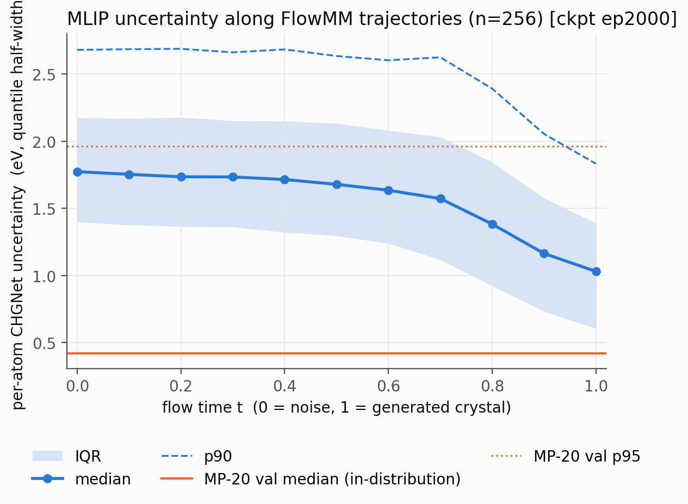
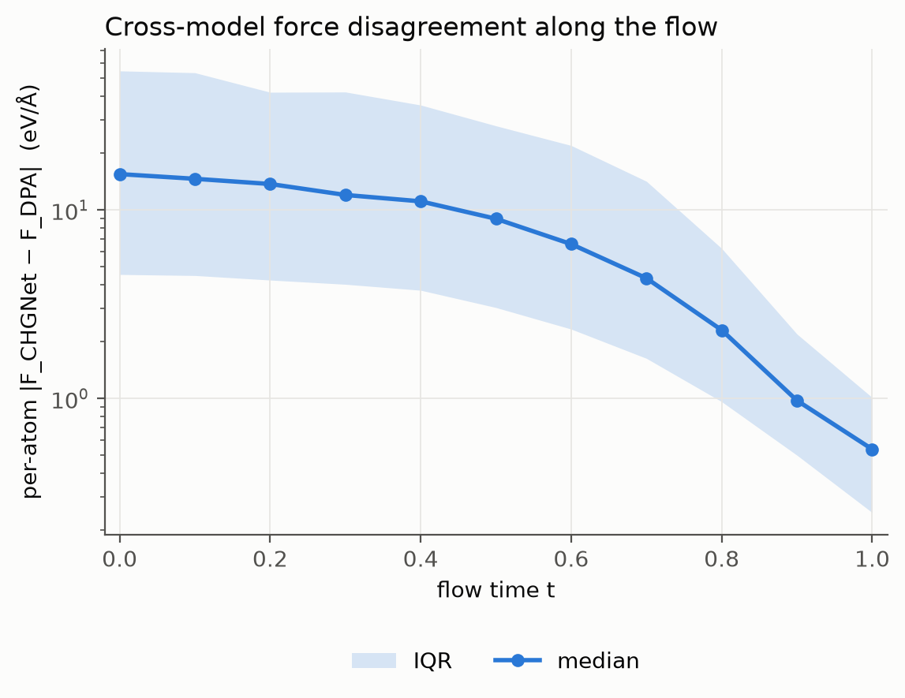
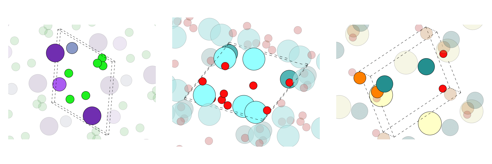

# TrustFlow

**Knowing When and Where to Trust Large Atomic Models in Crystal Generative Flows**
**面向晶体生成的可信大原子模型物理引导**

晶体生成模型（FlowMM）可以用大原子模型（CHGNet、DPA）提供的力做物理引导。但生成轨迹上的中间结构可能远离大原子模型的训练分布，此时它给出的力未必可靠。TrustFlow 研究一个在现有 energy-guidance 工作中被默认成立的前提：**大原子模型在生成轨迹的什么时间、哪些原子上值得相信。**

```
Crystal generator (FlowMM)  ──►  intermediate structures  ──►  Large Atomic Model (CHGNet / DPA)
                                                                          │
                                        when & where is it reliable?  ◄───┘
                                                                          │
                                              selective, atom-wise physics guidance  g = r · F
```

> 当前状态：**Milestone 0 完成**（轨迹可信度分析，2026-10-11）。尚未实现任何 guidance。

---

## 三个发现（MP-20 自训 FlowMM，256 条轨迹，24 688 个原子）

**1. 大原子模型的可靠性沿生成轨迹有明确的时间结构，且只在流的后 40% 恢复。**

| | t ≤ 0.4 | t = 1.0 | MP-20 验证集（分布内） |
|---|---|---|---|
| CHGNet per-atom 不确定性中位 (eV) | 1.7–1.8 | 1.03 | 0.42 |
| 超过分布内 p95 的原子比例 | 33–36 % | 8 % | 5 % |

<p align="center"></p>

**2. 两个独立的大原子模型在中间态上严重分歧。** CHGNet 与 DPA-3.1（同为 MPtrj 训练）的相对力分歧 |F_C − F_D| / (|F_C| + |F_D|) 中位数从 t = 0 的 0.56 降到 t = 1 的 0.19。早期两模型给出的力方向接近无关；无条件使用任一模型的力做引导都不可靠。这条证据不依赖任何不确定性方法。

<p align="center"></p>

**3. 现成的 per-atom 不确定性（UQ-MLIP 的 quantile GBM）能部分预测跨模型分歧，携带了力大小之外的信息，但在轨迹后期失效。** 固定 |F| 后，UQ 与分歧的条件 Spearman 为 0.30；t ≥ 0.8 时对相对分歧的 AUROC 降到 0.5 附近，而这正是物理引导最有作用的区间。**因此下一阶段的首要任务是 reliability estimator，而不是 guidance。**

完整数字、每次运行的设置与局限：[`PRELIMINARY_RESULTS.md`](PRELIMINARY_RESULTS.md)、[`EXPERIMENT_LOG.md`](EXPERIMENT_LOG.md)。全部六张图在 [`figures/m0_final/`](figures/m0_final/)。

---

## 项目结构

```
PROJECT_BRIEF.md          研究问题、三个 RQ、Milestone 0 范围与停止线
REFERENCE_CODE_MAP.md     FlowMM 与参考库的代码事实、数据流、已确认决策、环境方案
PRELIMINARY_RESULTS.md    Milestone 0 结果
EXPERIMENT_LOG.md         每次实验的设置与数字
src/flowmm/               FlowMM backbone（上游代码，采样部分未修改）
src/trustflow/            TrustFlow 自己的代码
  trajectory.py             轨迹 npz 数据契约、中间结构重建、几何预过滤
  chgnet_eval.py            CHGNet per-atom 力 / site energy / 64 维特征
  uq.py                     quantile GBM 不确定性（UQ-MLIP 方法的独立实现）
  dpa_eval.py               DPA（DeePMD-kit）per-atom 力，作为独立参考
  stats.py                  Spearman / AUROC / 分位分箱
scripts_analysis/         流水线脚本（见下）
tests/                    22 个单元测试，不依赖 torch / chgnet / deepmd
figures/m0_final/         最终结果图；figures/m0/ 为 epoch 1300 的早期版本（结论一致）
help_code/                只读参考实现，不属于本项目代码（见文末）
```

## 复现

两个 conda 环境：`flowmm`（训练、采样、CHGNet，见 `environment.yml` 与 `REFERENCE_CODE_MAP.md` §7 的踩坑记录）和 `mlip`（DPA，见 `ENV_MLIP.md`）。两者通过 `outputs/*/traj.npz` 与 parquet 表衔接。

```bash
# 1. 训练 FlowMM（flowmm 环境，RTX 4090 约 26 h；每 100 epoch 存一个 checkpoint）
WANDB_MODE=disabled python scripts_model/run.py data=mp_20 model=abits_params

# 2. 导出 256 条生成轨迹的全部中间状态
CKPT=<run_dir>/every_n_epochs/epoch=1999-step=212000.ckpt
python scripts_model/evaluate.py gen_trajectory "$CKPT" --num_samples 256 --batch_size 256 --num_steps 1000 --single_gpu --subdir m0_final
python scripts_model/evaluate.py consolidate "$CKPT" --subdir m0_final
python scripts_analysis/export_trajectory_npz.py "$(dirname "$CKPT")/m0_final/consolidated_gen_trajectory.pt" outputs/m0_final/traj.npz

# 3. CHGNet per-atom 评估 + 不确定性 + 图 1–4
python scripts_analysis/trajectory_mlip_eval.py outputs/m0_final/traj.npz outputs/m0_final/chgnet --n_steps 11 --save_atom_fea
python scripts_analysis/uq_train_mp20.py data/mp_20 outputs/m0/uq_chgnet --n_train 3000 --n_val 500
python scripts_analysis/uq_apply.py outputs/m0_final/chgnet outputs/m0/uq_chgnet
python scripts_analysis/plot_trajectory_reliability.py outputs/m0_final/chgnet --uq_dir outputs/m0/uq_chgnet --out figures/m0_final

# 4. DPA 参考力 + 跨模型分歧 + 图 5–6（mlip 环境）
python scripts_analysis/trajectory_dpa_eval.py outputs/m0_final/traj.npz outputs/m0_final/dpa --n_steps 11
python scripts_analysis/cross_mlip_analysis.py outputs/m0_final/chgnet outputs/m0_final/dpa --out figures/m0_final
```

每个脚本都写出 `meta.json`，记录参数、步数、样本数和耗时。`python -m pytest tests -q` 运行单元测试。

## 路线

| 阶段 | 内容 | 状态 |
|---|---|---|
| Milestone 0 | 轨迹可信度分析：CHGNet UQ 与 CHGNet–DPA 分歧沿轨迹、沿原子的分布 | 完成 |
| 1 | Reliability estimator 对比：site-energy 分位宽度 vs 以跨模型分歧为目标的 GBM vs embedding 距离 vs DPA 多模型 deviation，评价标准为 t ≥ 0.8 的 AUROC | 下一步 |
| 2 | 固定物理引导 baseline，测量 negative transfer rate | |
| 3 | TrustFlow：基于最优 estimator 的 atom-wise selective guidance，与无引导 / 固定引导的 paired experiments | |

## 关于 `help_code/`

`help_code/` 下是只读的参考实现：UQ-MLIP、CHGNet、DeePMD-kit、DiffCSP、OMatG。它们用于理解接口和已有方法，不属于 TrustFlow 的实现，也未被修改。`src/trustflow/uq.py` 是 UQ-MLIP 方法的独立重写，以便在不同 Python 版本的环境中使用。

---
---

# Backbone: FlowMM（上游 README 原文）

以下为 [facebookresearch/flowmm](https://github.com/facebookresearch/flowmm) 的原始 README，本仓库的 `src/flowmm`、`scripts_model`、`data` 均来自该项目。TrustFlow 未修改其采样代码。

# FlowMM: Generating Materials with Riemannian Flow Matching

<div align="center">

[](https://arxiv.org/abs/2406.04713)
[](https://twitter.com/bkmi13/status/1803038219790942565)

</div>

### Crystal Structure Prediction

<p align="center">

</p>

### De Novo Generation

<p align="center">

</p>

# Installation

Follow the steps to get the files:

```bash
# clone this repo into the folder flowmm/
cd flowmm
git submodule init
git submodule update
bash create_env_file.sh  # creates the necessary .env file
```

The submodules include [CDVAE](https://arxiv.org/abs/2110.06197), [DiffCSP](https://arxiv.org/abs/2309.04475), and [Riemannian Flow Matching](https://arxiv.org/abs/2302.03660).

Now we can install `flowmm`. We recommend using `micromamba` because conda is extremely slow. You can install `micromamba` by [following their guide](https://mamba.readthedocs.io/en/latest/installation/micromamba-installation.html#automatic-install). If the installation fails, try again a few more times.

```bash
micromamba env create -f environment.yml
```

Activate using

```bash
micromamba activate flowmm
```


# Data

The training data is in `.csv` format in `data/`. When you first train on it, the script will convert the data into a faster-to-load format.

If you want to compute energy above hull, you must [download the convex hull from 2023-02-07](https://figshare.com/articles/dataset/Matbench_Discovery_v1_0_0/22715158?file=40344451). Extract the files to the folder `mp_02072023/`. We got this hull from [Matbench Discovery](https://matbench-discovery.materialsproject.org/).


# Experiments

The various datasets you can train on are as follows:
```
data \in {perov, carbon, mp_20, mpts_52}
```

There are a few preselected `model` options in `scripts_model/conf/model`. The format is `{atom_type_manifold}_{lattice_manifold}`.

Atom type manifolds:
- `abits` - [analog bits](https://arxiv.org/abs/2208.04202) proposed for use in FlowMM
- `null` - used for conditional generation
- `simplex` - the method used to fit the atom types in DiffCSP

Lattice manifolds:
- `nonsym` - the method to fit the lattice in DiffCSP
- `params` - our proposed method in FlowMM, lattice parameters
- `params_normal_base` - ablated version where the lattice parameters base distribution is gaussian and not sent to constrained space.

### Conditional Training

```bash
python scripts_model/run.py data=perov model=null_params
```

### Unconditional Training

```bash
python scripts_model/run.py data=perov model=abits_params
```

## Evaluation

Discussion about evaluation is limited to FlowMM. `scripts_model/evaluate.py` uses `click`, allowing it to serve as a multi-purpose evaluation program.

### Conditional Evaluation - Crystal Structure Prediction - Reconstruction

These commands will:  
1. reconstruct the `test` set
2. consolidate the results into a single torch pickle with the correct format
3. compute the match rate and root mean square error, compared to the `test` set
4. create plots of the distribution of lattice parameters, compared to the `test` set

The user must provide `PATH_TO_CHECKPOINT`, `NAME_OF_SUBDIRECTORY_AT_CHECKPOINT`, `SLOPE_OF_INFERENCE_ANTI_ANNEALING`.

```bash
ckpt=PATH_TO_CHECKPOINT
subdir=NAME_OF_SUBDIRECTORY_AT_CHECKPOINT
slope=SLOPE_OF_INFERENCE_ANTI_ANNEALING
python scripts_model/evaluate.py reconstruct ${ckpt} --subdir ${subdir} --inference_anneal_slope ${slope} --stage test && \
python scripts_model/evaluate.py consolidate ${ckpt} --subdir ${subdir} && \
python scripts_model/evaluate.py old_eval_metrics ${ckpt} --subdir ${subdir} --stage test && \
python scripts_model/evaluate.py lattice_metrics ${ckpt} --subdir ${subdir} --stage test
```

### Unconditional Evaluation - De Novo Generation

These commands will:
1. generate 10k structures from a checkpoint
2. consolidate the results into a single torch pickle with the correct format
3. compute the De Novo Generation proxy metrics, compared to the `test` set
4. create plots of the distribution of lattice parameters, compared to the `test` set

The user must provide `PATH_TO_CHECKPOINT`, `NAME_OF_SUBDIRECTORY_AT_CHECKPOINT`, `SLOPE_OF_INFERENCE_ANTI_ANNEALING`.

```bash
ckpt=PATH_TO_CHECKPOINT
subdir=NAME_OF_SUBDIRECTORY_AT_CHECKPOINT
slope=SLOPE_OF_INFERENCE_ANTI_ANNEALING
python scripts_model/evaluate.py generate ${ckpt} --subdir ${subdir} --inference_anneal_slope ${slope} && \
python scripts_model/evaluate.py consolidate ${ckpt} --subdir ${subdir} && \
python scripts_model/evaluate.py old_eval_metrics ${ckpt} --subdir ${subdir} --stage test && \
python scripts_model/evaluate.py lattice_metrics ${ckpt} --subdir ${subdir} --stage test
```

#### Prerelaxation

Taking the generations from the previous step, we can prerelax them using [CHGNet](https://chgnet.lbl.gov/) on the cpu. This script works locally, but it is designed to parallelize the process over nodes on a slurm cluster.

If you want to use slurm, the user must then provide `YOUR_SLURM_PARTITION`.

```bash
# get the path to the structures 
eval_for_dft_pt=$(python scripts_model/evaluate.py consolidate "${ckpt}" --subdir "${subdir}" --path_eval_pt eval_for_dft.pt | tail -n 1)

# get the eval_for_dft_json
parent=${eval_for_dft_pt%/*}  # retain part before the last slash
eval_for_dft_json="${eval_for_dft_pt%.*}.json"  # retain part before the period, add .json
log_dir="${parent}/chgnet_log_dir"

# set other flags, if you are using slurm.
num_jobs=1
slurm_partition=YOUR_SLURM_PARTITION

# prerelax
python scripts_analysis/prerelax.py "$eval_for_dft_pt" "$eval_for_dft_json" "$log_dir" --num_jobs "$num_jobs" --slurm_partition "$slurm_partition"
```

#### Preparing Density Functional Theory

We can continue by doing density functional theory (DFT) with [VASP](https://www.vasp.at/).

The user must provide `PATH_TO_YOUR_PSEUDOPOTENTIALS`, which requires a VASP license.

```bash
export PMG_VASP_PSP_DIR=PATH_TO_YOUR_PSEUDOPOTENTIALS 

# create the folder to hold the dft files
dft_folder="${parent}/dft"
mkdir -p "$dft_folder"

# create the dft inputs
python scripts_analysis/dft_create_inputs.py "${eval_for_dft_json}" "${dft_folder}"
```

We do not provide guidance on running DFT.

We note that your DFT results should typically be [corrected using the settings from the Materials Project](https://docs.materialsproject.org/methodology/materials-methodology/thermodynamic-stability/thermodynamic-stability).


#### Computing Energy Above Hull

We can compute the energy above hull using the (corrected) DFT relaxed energies or the CHGNet prerelaxed energies.

Note: This whole section requires downloading the convex hull from above!

If you want to use the CHGNet prerelaxed energies you can use the following commands. Since the prerelaxed energies are generally inaccurate, they go in their own column in the `.json` file. The prerelaxed energy above hull from CHGNet will be computed whether or not DFT relaxations were run.

```bash
json_e_above_hull="${parent}/ehulls.json"
python scripts_analysis/ehull.py "${eval_for_dft_json}" "${json_e_above_hull}"
```

If you want to use your DFT calculations you can use the following code. Our script expects that `clean_outputs` contains trajectory files with name `######.traj` where `######` corresponds to the index of the corresponding row in the `${eval_for_dft_json}` file.

```bash
clean_outputs_dir="${parent}/clean_outputs"
json_e_above_hull="${parent}/ehulls.json"
python scripts_analysis/ehull.py "${eval_for_dft_json}" "${json_e_above_hull}" --clean_outputs_dir "${clean_outputs_dir}"
```

##### Computing the Corrected Energy Above Hull

We have a script which does the corrections for you, but it must correspond to our format. There must be a root directory that has (1) a subdirectory called `dft`, which was created using `scripts_analysis/dft_create_inputs.py` and (2) a subdirectory called `clean_outputs`, which contains trajectory files with name `######.traj` where `######` corresponds to the index of the corresponding row in the `${eval_for_dft_json}` file.

```bash
root_dft_clean_outputs="${parent}"
ehulls_corrected_json="${parent}/ehulls_corrected.json"
python scripts_analysis/ehull_correction.py "${eval_for_dft_json}" "${ehulls_corrected_json}" --root_dft_clean_outputs "${root_dft_clean_outputs}"
```

#### Computing S.U.N.

The most accurate estimates of S.U.N. structures occur when using corrected DFT relaxed energies.

```bash
sun_json=sun.json
python scripts_analysis/novelty.py "${eval_for_dft_json}" "${sun_json}" --ehulls "${ehulls_corrected_json}"
```

# FlowLLM Model

The FlowLLM model combines RFM and [CrystalLLM](https://arxiv.org/abs/2402.04379) by using the LLM as a learned base distribution for the RFM model.

To train the FlowLLM from scratch, you need to train the CrystalLLM model first: Get the CrystalLLM codebase from [https://github.com/facebookresearch/crystal-text-llm](https://github.com/facebookresearch/crystal-text-llm). Follow the instructions in that repo to fine-tune a LLaMA model on the MP-20 dataset. After training, generate a large number of samples from that model and create a dataset to train the RFM model. 
For convenience, a subset of the data used in the FlowLLM paper is available in: `data/mp20_llama/`.

Once this training data has been created, the FlowLLM model can be trained just like FlowMM with Conditional Training. Be sure to set `base_distribution_from_data=True` to read the initial samples from the dataset file.

```bash
python scripts_model/run.py data=mp20_llama model=null_params base_distribution_from_data=True
```


# Citation

If you find this repository helpful for your publications, please consider citing our papers:

```
@inproceedings{
    miller2024flowmm,
    title={Flow{MM}: Generating Materials with Riemannian Flow Matching},
    author={Benjamin Kurt Miller and Ricky T. Q. Chen and Anuroop Sriram and Brandon M Wood},
    booktitle={Forty-first International Conference on Machine Learning},
    year={2024},
    url={https://openreview.net/forum?id=W4pB7VbzZI}
}

@inproceedings{
    sriram2024flowllm,
    title={FlowLLM: Flow Matching for Material Generation with Large Language Models as Base Distributions},
    author={Anuroop Sriram and Benjamin Kurt Miller and Ricky T. Q. Chen and Brandon M. Wood},
    booktitle={NeurIPS 2024},
    year={2024},
    url={}
}
```

# License

`flowmm` is CC-BY-NC licensed, as found in the `LICENSE.md` file. However, the git submodules may have different license terms:
- `cdvae`: MIT License
- `DiffCSP-official`: MIT License
- `riemmanian-fm`: [CC BY-NC 4.0 License](https://creativecommons.org/licenses/by-nc/4.0/)

The licenses for the dependencies can be viewed at the corresponding project's homepage.
